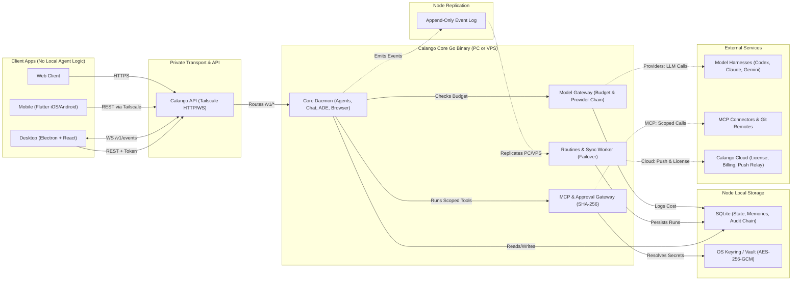
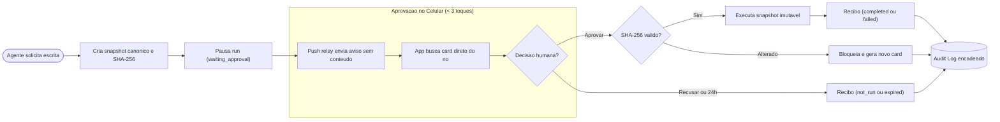
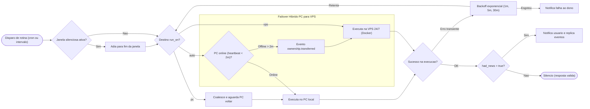

# Calango V1 — Design System & Modelagem no Figma

Documento de referência da modelagem visual e de produto do **Calango** no Figma, derivada de [site/index.html](../site/index.html), [DEV/BRAND/BRAND.md](BRAND/BRAND.md), [packages/tokens/tokens.json](../packages/tokens/tokens.json), [DEV/PLANO.md](PLANO.md) e das especificações em [DEV/SPECS/modules/](SPECS/modules/).

## Links Oficiais

- **Figma Design (Design System + 21 telas):** <https://www.figma.com/design/vnna5rthWR8aXWBRYo85Tb>
- **FigJam (Arquitetura + Fluxos críticos):** <https://www.figma.com/board/1Ndfzz7qgPHxLFbA9iEDr6>
- **Manifesto de IDs e Tokens:** [packages/tokens/figma-manifest.json](../packages/tokens/figma-manifest.json)

---

## 1. Fundações & Tokens (Página 1 — `01 · Design System`)

### Variáveis Figma
Mapeadas com `scopes` explícitos e `codeSyntax` `WEB` apontando para as variáveis CSS do projeto:

- **`Primitives`** (34 tokens): cores de marca (`postit`, `postit-light`, `postit-deep`, `lime`, `leaf`, `moss`, `btn-primary`, `tangerine`, `sand`, `clay`, `clay-deep`, `bark`, `danger`), neutros Light/Dark e alphas.
- **`Color` (Dark)** e **`Color Light` (Light Solar)** (25 tokens semânticos cada, aliando para `Primitives`): `bg/canvas`, `bg/surface`, `bg/elevated`, `bg/ade`, `bg/ide`, `bg/brand-postit`, `bg/brand-primary`, `bg/status-ok`, `bg/status-warn`, `bg/status-danger`, `bg/accent-soft`, `text/*`, `border/*`, `dot/*`.
  - *Nota do plano Starter:* no Figma Starter cada coleção suporta 1 modo; por isso Dark (`Color`) e Light (`Color Light`) foram separados em duas coleções aliadas aos mesmos primitivos, prontas para unificação em modos quando o time migrar para Professional.
- **`Scale`** (13 tokens): espaçamentos (`spacing/2xs` a `spacing/3xl`) e raios (`radius/xs` a `radius/full`).

### Tipografia e Sombras
- **12 Text Styles** com as fontes oficiais:
  - `Bricolage Grotesque` (`Display/Hero`, `Display/H1`, `Display/H2`, `Heading/H3`)
  - `Instrument Sans` (`Body/Large`, `Body/Regular`, `Body/Medium`, `Body/SemiBold`, `Body/Small`)
  - `JetBrains Mono` (`Label/Caps`, `Mono/Badge`, `Mono/Code`)
- **2 Effect Styles:** `Shadow/Paper` e `Shadow/Lift`.

### Biblioteca de Componentes (6 Variant Sets / Componentes)
- `Button` (`Primary`, `Postit`, `Ghost`, `Danger`)
- `Badge` (`OK`, `Warn`, `Postit`, `Neutral`, `Danger`)
- `NodePill` (`PC-Online`, `PC-Offline`, `VPS-Online`, `VPS-Working`)
- `NavItem` (`Default`, `Active`)
- `ApprovalCard` (`Pending`, `Approved`, `Failed` — com ação exata, digest SHA-256 e recibo separado da decisão)
- `StatCard` (métrica mensal de gateway/tokens)

### Motion & Personalidade
- Seção `03 · Motion, Personalidade & Trocadilhos` com keyframes reais (`TRANSLATION_Y` + `OPACITY`, curva `ease-paper` `cubic-bezier(0.2, 0.9, 0.25, 1.15)` e *stagger* progressivo), além da logo oficial (`site/assets/logo-512.png`) no Cover com flutuação suave.

---

## 2. Telas Desktop (Página 2 — `02 · Desktop`, 1440×900)

### Fase 1 — MVP Local (7 telas)
| Código | Tela | Escopo |
|---|---|---|
| `D1` | Conversas + Steps + Aprovação (Dark) | DMs, steps em tempo real, card de aprovação SHA-256, `Steer`/`Stop` |
| `D1-Light` | Conversas + Aprovação (Light Solar) | Mesma tela no tema solar do site (`Color Light`) |
| `D2` | Para Você (Inbox) & Aprovações | Briefing diário, fila ordenada por `seq`, recibos `completed`/`failed` |
| `D3` | Agentes & Cadeia de Provedores | Cadeia ordenada (ADR 0016), esforço (`low/medium/high/max`), orçamento mensal |
| `D4` | Rotinas Automáticas | Cron/intervalo, `run_on`, janela silenciosa, `notify_on=news`, retry e `occurrence_id` |
| `D5` | Uso & Custos + Memória & Conectores MCP | KPIs do gateway, memórias revisáveis e escopos MCP por turno (ADR 0018) |
| `D6` | Cofre, Auditoria & Pareamento QR | OS Keyring (nomes/datas), hash chain verificável, código 8 chars + QR |

### Fases 3–6 — Módulos Avançados (5 telas)
| Código | Tela | Escopo |
|---|---|---|
| `A1` | Híbrido PC ↔ VPS, Sync & Planos | Heartbeat 15s, failover `ownership.transferred`, planos Grátis / Pro / Equipe |
| `A2` | ADE (sempre escuro) | 2 worktrees paralelas, editor/diff, terminal PTY (`xterm.js`), evidências e gate de merge |
| `A3` | Navegador Interno (`WebContentsView` + CDP) | Perfil isolado, banner de barreira (CAPTCHA) e botão *Assumir controle da aba* |
| `A4` | Computer Use | Opt-in por aplicativo, apps bancários bloqueados por padrão e parada `< 1s` |
| `A5` | Canais & Equipes | Canal com pessoas + agentes, escolha do Roteador no topo da resposta e aprovação delegada |

---

## 3. Telas Mobile Flutter (Página 3 — `03 · Mobile Flutter`, 390×844)

| Código | Tela | Escopo |
|---|---|---|
| `M1` | Boas-vindas & Pareamento QR | Câmera QR + código de 8 caracteres + Keychain E2E |
| `M2` | Nós (PC & VPS) | Estado online/offline, "desde quando" e pendências |
| `M3` | Push na Tela Bloqueada | Tema post-it do site, aprovação `< 3 toques` via Tailscale |
| `M4` | Aprovação Detalhada | Ação exata, alvo, argumentos, digest SHA-256 e *Sempre aprovar* |
| `M5` | Para Você (Inbox) | Briefing diário, aprovações, perguntas e entregas |
| `M6` | Conversas | DMs com steps resumidos e card de próximos passos (checkboxes) |
| `M7` | Rotinas & Tarefas | Lista de rotinas (*Rodar agora* / *Pausar*) e alternância para Board |
| `M8` | Configurações & Plano | Assinatura unificada, dispositivos, notificações e i18n |
| `M9` | Controle Remoto da Tela do PC | Stream E2E auditado com aviso visível no PC e encerramento `< 1s` |

---

## 4. Diagramas de Arquitetura e Fluxos (FigJam)

### 4.1 Arquitetura Híbrida (PC, VPS & Celular)

### 4.2 Fluxo de Aprovação Imutável (SHA-256 & Recibo)

### 4.3 Failover Híbrido PC ↔ VPS & Rotinas

---

## 5. Próxima iteração planejada no Figma

Devido ao limite mensal de chamadas MCP do plano Figma Starter atingido em 2026-11-26, ficaram mapeados para a próxima janela (ou após upgrade de plano):
- Ajuste fino de `CROP` da logo PNG no Cover (`19:5`) e remoção do fundo do grid de *Motion* (`19:14`);
- Substituição das logos nos sidebars Desktop (`02 · Desktop`) pela PNG oficial;
- Novas telas solicitadas: `X1 · Projetos & Repositórios`, `X2 · Agentes Trabalhando Ao Vivo`, `X3 · Agentes nos Canais Conectados`, `X4 · Tarefas (Board Kanban)`, `X5 · Configurações Desktop` e `W1 · Landing Page` (`site/index.html`) + conexões clicáveis de protótipo.
