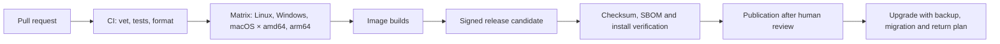

# Technical delivery pipeline — development and release

Updated 2026-11-23. This document distinguishes what is implemented from the gates planned for V1.

## Product flow

```text
Desktop / Mobile / Web
        │ SDK generated from OpenAPI; credential per device
        ▼
calango node API ── authentication, validation, request limits
        │
        ├── domain and persistent execution ── local SQLite, immutable migrations
        ├── model gateway ── budget before, cost/usage after
        ├── tool gateway ── MCP scopes and approval for sensitive writes
        └── events ── WebSocket for clients; node events for replication
                  │
                  ├── the person's PC
                  └── the person's VPS, through the configured transport
```

The client is a control surface. `calango` is the only agent executor; the gateway is the only exit for model calls; approvals belong to people and typed tools. The real topology and trust boundaries are in `ARCHITECTURE.md`, `PRODUCT_HYBRID.md` and `SECURITY.md`.

## Code-to-release flow



### Existing gates

| Gate | Status in this review | Evidence |
|---|---|---|
| `go vet ./...`, `go test ./...`, `gofmt` | Implemented in the workflow and run locally. | `.github/workflows/ci.yml`, `DEV/VERIFY.md` |
| Cross-build of six targets | Workflow and six local builds verified; GitHub Actions run 45188079827 on `dee8efa` passed. Current uncommitted changes are not covered by that run. | `.github/workflows/ci.yml`, `DEV/VERIFY.md` |
| Matriz nativa Linux, Windows e macOS | Workflow `ci-nativa` (issue #120): testes Go com `-race`, testes do desktop, smoke do daemon e gate `ci-nativa-gate`. Não homologa Linux/macOS; keyring real e assinatura ficam isolados. | `.github/workflows/ci-nativa.yml`, `DEV/CI_NATIVA.md` |
| Site image build | Workflow builds the image; local run depends on access to the Docker daemon. | `Dockerfile`, `.github/workflows/ci.yml` |
| Node image build | Workflow builds the image; missing an HTTP execution gate for the image in CI. | `deploy/Dockerfile.node`, `.github/workflows/ci.yml` |
| OpenAPI semantic lint | Implemented in CI with Redocly CLI 2.81.0 pinned; current local lint is valid with one non-blocking warning. Run 45188079827 passed on `dee8efa`; current uncommitted changes need a later authorized push for CI coverage. | `api/openapi.yaml`, `.github/workflows/ci.yml` |
| Offline local backup/restore | Runbook covers the full data directory and key source; a pre-migration restore test passes. Previous-binary compatibility and OS-keyring recovery remain unverified. | `BACKUP_RESTORE.md`, `internal/store/backup_restore_test.go` |
| Token generation and drift check | Implemented for CSS and TypeScript/Dart constants; `--check` runs in CI. | `scripts/generate-tokens.mjs`, `packages/tokens/generated/`, `.github/workflows/ci.yml` |
| SDK and i18n generation | TypeScript SDK and i18n catalog generators are implemented with drift checks; Dart SDK is phase 2. | `api/`, `packages/sdk-ts`, `packages/i18n`, `DEV/TODO_V1.md` |
| Desktop install, signing, update and rollback | Electron beta exists and runs on Linux; signed installers, Windows/macOS acceptance and signed app updates remain open. | `apps/desktop`, `SPECS/modules/desktop-electron.md`, TODO V1 |
| Linux desktop packages and license gate | `.deb` and AppImage x64 with the embedded daemon; `verify-desktop-package.mjs` fails if `LICENSE`, `NOTICE` or `third_party/` are missing or differ; CI job `desktop-linux-package` installs, upgrades, runs the daemon and the app (Xvfb) and purges in clean Debian 12 and Ubuntu 24.04 containers, without uploading artifacts. Unsigned; macOS DMG configured but waits for Apple credentials and notarization. | `apps/desktop/electron-builder.yml`, `scripts/test-linux-package.sh`, `DEV/PACOTE_DESKTOP_LINUX_MACOS.md` |

## V1 release pipeline

1. **Contract:** change the OpenAPI before the handler; validate schema and references; generate the TypeScript/Dart SDK repeatably and fail CI on drift. Tokens and the i18n catalog already have a source, a reproducible generator and a drift gate in CI (F0-T07).
2. **CI per PR:** `gofmt`, vet, unit tests, migration tests, cross builds, OpenAPI lint, token validation, dependency/license analysis and security checks. Integration that uses Docker runs on a runner with a daemon, without depending on third-party services or real keys.
3. **Release builds:** Go binary per OS/architecture; Electron app per system; Flutter per store; multi-architecture OCI images. Each artifact gets an immutable version, checksum and SBOM. Publication does not use `latest` as an operational identifier.
4. **Signing and provenance:** sign installers and desktop updates; notarize macOS; publish digest and signature of the images; keep licenses and `NOTICE`. Signing secrets live only in a protected release environment, never in a fork's PR.
5. **Promotion:** the release candidate goes through a clean install, an upgrade from the previous version, a health check, a smoke test of critical flows and human review. Stable/beta channels promote the same immutable artifact, without rebuilding.
6. **Database and return:** before a migration, ensure a restorable backup; applied migrations are never edited. A migration failure blocks promotion. Application rollback is allowed only if the previous schema remains compatible; otherwise restore the backup or publish a forward corrective migration.
7. **Operation:** observe startup, health, routine failures, approval queue and gateway usage without recording prompts, private content or secrets. External telemetry stays opt-in. Record version, node and error code for support.

## Pipeline security rules

- Do not publish an artifact that was not built by the pipeline from a reviewed tag.
- Do not include credentials in an image, artifact, log, source map or SDK.
- Do not approve merge, publication, payment or deploy automatically by the model's decision.
- Maestro updates remain subject to ADR 0009 (amended for D6): automatic update is on by default and always runs `verify`, with rollback.
- CI network access is minimal and explicit. Unit tests use a fake provider; integration tests use ephemeral environments and disposable data.

## Gaps to close

- Revalidate the workflow on GitHub after the next authorized push; run 45188079827 on `dee8efa` succeeded.
- Generate the Dart SDK in phase 2; TypeScript SDK and i18n drift checks are implemented.
- Make CI run the images and query their health checks; repeat locally once the Docker daemon is accessible.
- Define tools and blocking levels for dependency analysis, SBOM and image scanning; document exceptions with an expiry date.
- Implement the signing, provenance, publication and rollback chain before distributing the first public installer.
- Validate rollback with the previous binary and real OS keyring; the current snapshot test only proves a pre-migration restore followed by migration in the current binary.
